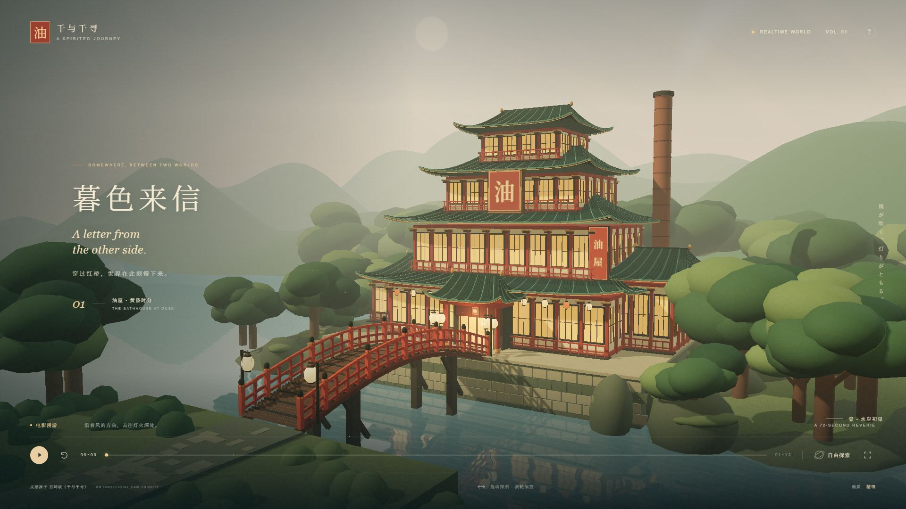

# 油屋 · 暮色来信

以《千与千寻》的汤屋与红桥为灵感的实时 Web3D 场景。四段连续运镜从水岸走向红桥、抬头看屋檐，最终停留在蓝紫暮色中。默认无声，全部模型、材质、招牌、水面与环境均由本地代码生成，无需下载模型或调用外部服务。



## 本地运行

需要 Node.js 22.12+ 或 24+，以及支持 WebGL 2 的现代浏览器。

```powershell
npm install
npm run dev
```

打开终端显示的地址，默认是 `http://127.0.0.1:5173/`。如果 PowerShell 限制 npm 脚本，可以使用 `npm.cmd` 代替 `npm`。

```powershell
npm test           # 时间轴、状态切换和路径安全测试
npm run build     # TypeScript 检查并生成 dist/
npm run preview   # 预览生产构建
```

若本机 npm 镜像不可用，安装时可添加 `--registry=https://registry.npmjs.org`。已提供 package-lock.json，重复安装可用 `npm ci`。生产文件可以放入任何静态 HTTP 服务；不要直接以 file:// 打开 index.html。

## 体验方式

| 操作 | 行为 |
| --- | --- |
| 播放 / 暂停、空格 | 控制电影时间轴 |
| 进度条 | 跳转画面，同步更新天色 |
| 拖动画面 | 暂停电影并进入受限环绕查看 |
| 滚轮 / 双指缩放 | 调整与建筑的距离 |
| 返回电影 | 约 1.2 秒平滑回到暂停机位，继续播放 |
| 左右方向键 | 后退 / 前进 5 秒（焦点不在控件内时） |
| 重播按钮 / 左上角标识 | 回到开场并重新播放 |
| 画质按钮 | 自动 → 精细 → 流畅 |
| 右上角问号 | 查看操作说明，打开时暂停电影 |

电影在 72 秒结束后停留于最终构图。浏览器后台时停止渲染和推进；恢复时不会跳过镜头。系统开启“减少动态效果”时，默认静止，水纹、微粒与蒸汽也保持静态，可主动点击播放。首屏文案在 11 秒后淡出；播放中的控制栏闲置后隐藏，移动鼠标、触摸或键盘操作会唤回。

## 场景与结构

- `src/architecture.ts`：四层主体、侧楼、烟囱、曲面歇山屋顶、瓦垄、窗格、灯笼、招牌、红桥及石基。桥板、栏杆、立柱使用同一弧线计算高度。
- `src/materials.ts`：确定性随机数、程序化纸感纹理、Canvas 招牌和按材质/几何体分组的实例化构件。
- `src/world.ts`：树林与岩岸、远山、渐变天空、反射水面、日光、薄雾、蒸汽和后续画质调整。
- `src/cinema.ts`：`Shot` 机位配置、Catmull–Rom 轨迹、缓入缓出、竖屏构图和独立 `Timeline` 状态机。
- `src/main.ts`：渲染循环、后期处理、OrbitControls、DOM 控件、画质适配、后台恢复及错误提示。
- `src/style.css`：全屏排版、移动端适配和控件状态。
- `tests/cinema.test.ts`：时间轴边界、结束重播、自由查看/返回、减少动态效果及连续路径验证。

### 镜头

| 时间 | 章节 | 画面 |
| --- | --- | --- |
| 0–14 秒 | 水岸初见 | 侧前方开场，逐渐移动到桥前 |
| 14–34 秒 | 走过红桥 | 沿桥推进，以栏杆形成近景视差 |
| 34–52 秒 | 灯火苏醒 | 抬升视线，展示层叠屋檐与“油”字招牌 |
| 52–72 秒 | 暮色来信 | 退至侧前方全景，灯火增强并停留 |

`Shot.position` / `Shot.target` 描述每段起始机位与注视点；末段终点单独配置，所有片段共享连续曲线。`sampleCamera(time, aspect)` 返回位置、目标、视野和章节。`Timeline` 提供 `play`、`pause`、`seek`、`restart`、`explore` 和 `returnToCinema`，模式为 `cinema`、`explore`、`returning`。进入自由查看和返回过渡期间，电影时间冻结。

### 性能策略

约 6,400 个重复构件按几何体与材质实例化；屋面瓦垄合并成少量网格。阴影按需更新；精细模式使用 1024² 倒影和轻微 Bloom，流畅模式使用 384² 倒影、每三帧更新一次、关闭 Bloom，并将像素比限制在 1。自动模式在小屏启动时选择流畅画质，桌面若持续采样低于 32 FPS 则降级。

开发时可在 DOM 的 `#app` 上读取 `data-fps`、`data-quality`、`data-draw-calls`、`data-triangles`、`data-time`、`data-mode`。FPS 以最近约两秒的前台 requestAnimationFrame 采样计算；三角形和 draw call 包含当帧反射与后期通道。

## 验证与截图

验证过程与限制见 [验收记录](docs/verification.md)。

| 截图 | 内容 |
| --- | --- |
| [水岸初见](docs/screenshots/01-waterfront.jpg) | 开场，0 秒 |
| [走过红桥](docs/screenshots/02-red-bridge.jpg) | 红桥推进，26 秒 |
| [灯火苏醒](docs/screenshots/03-lanterns.jpg) | 屋檐近景，44 秒 |
| [暮色来信](docs/screenshots/04-blue-hour.jpg) | 终镜头，72 秒 |
| [手机布局](docs/screenshots/05-mobile.jpg) | 390×844 竖屏 |

这是非官方的建筑与环境致敬作品，未使用电影截图、配乐或外部角色资产。重建依据建筑特征与美术氛围，并非指定电影画面的逐帧匹配。
